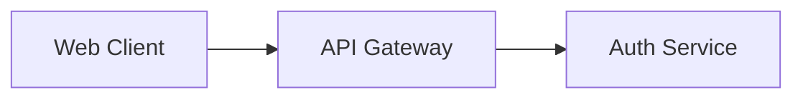
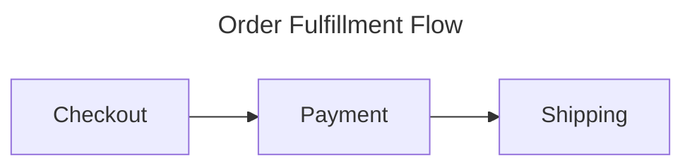

# Core Principles for Quality Mermaid Diagrams

These principles apply to every diagram type. They address the most common failure
modes of generated diagrams: too much content, meaningless identifiers, decorative
styling, and diagrams that restate the prose instead of showing structure.

## 1. A diagram must earn its place

Only draw a diagram when spatial structure communicates something prose cannot:
branching, cycles, concurrency, layering, lifecycles, or many-to-many relationships.
A linear 3-step process is better as a numbered list. If the diagram would just be
boxes in a straight line, don't draw it.

## 2. One idea per diagram, 5–15 nodes

Readers parse diagrams in one glance or not at all. Target 5–15 nodes per diagram.
Above that, split by concern (e.g., one diagram for the request path, another for the
data pipeline) and link them with prose. A single "everything" architecture diagram is
the classic generated-diagram failure: technically complete, practically unreadable.

Corollary: show one level of abstraction per diagram. Don't mix "load balancer" with
"the `retryCount` variable" in the same picture.

## 3. Semantic IDs, human labels — always separated, labels always quoted

- Node IDs are code: stable, lowerCamelCase or snake_case, meaningful (`authSvc`,
  not `A`/`B`/`C`). Single-letter IDs make the source unmaintainable and force the
  next editor to decode the whole diagram.
- Labels are for humans: 1–5 words, sentence fragments, no implementation trivia.
- Always wrap labels in double quotes. It costs nothing and eliminates an entire
  class of parse errors from `()`, `[]`, `{}`, slashes, and keywords
  (see [05-syntax-pitfalls.md](05-syntax-pitfalls.md)).

## 4. Short labels; detail lives in prose

Node labels of 1–5 words. Edge labels of 1–3 words, and only where they add meaning:
decision outcomes (`Yes` / `No`), event names, protocols. Labeling every edge with
"calls" or "sends data to" is noise. If a label needs a second line, use ` `
sparingly — and treat its presence as a hint the content belongs in surrounding text.

## 5. Shapes carry meaning — use them consistently

Pick a shape vocabulary and keep it consistent within a document set:

| Shape | Syntax | Conventional meaning |
|---|---|---|
| Rectangle | `id["label"]` | Process / component / step |
| Rounded | `id("label")` | Start/end of a soft flow, external action |
| Stadium | `id(["label"])` | Start / end terminator |
| Diamond | `id{"label"}` | Decision |
| Cylinder | `id[("label")]` | Database / datastore |
| Parallelogram | `id[/"label"/]` | Input / output |
| Hexagon | `id{{"label"}}` | Preparation / special operation |
| Double circle | `id((("label")))` | Stop / emphasized terminal |

Mixing shapes decoratively (a hexagon here, a stadium there, because variety "looks
nice") destroys the vocabulary. Every shape change should answer "what kind of thing
is this?"

## 6. Title and accessibility metadata on every non-trivial diagram

- `title:` in frontmatter renders a visible title.
- `accTitle:` / `accDescr:` emit SVG `<title>`/`<desc>` for screen readers.
  `accDescr` supports a multiline block form: `accDescr { ... }`.

## 7. Color is information, not decoration

Use at most 3–4 accent colors, each with a stated meaning (e.g., "red = failure path,
green = happy path, grey = external system") via semantic `classDef` names. Never rely
on color alone — pair it with shape, edge style, or label so the meaning survives
grayscale and color-blind viewing. Diagrams with per-node random pastels read as
clipart, and are the second-classic generated-diagram failure after oversized scope.

## 8. The source is code — format it like code

- One statement per line; no semicolons (they're optional and add noise).
- Declare in reading order: nodes/flows first in the order a reader should encounter
  them, then styling (`classDef`, `class`) grouped at the bottom.
- Indent subgraph contents.
- `%%` comments for anything non-obvious (but never `{}` inside a comment — it
  confuses the parser).

## Sources

- Mermaid syntax reference — structure, breaking-change notes:
  <https://mermaid.js.org/intro/syntax-reference.html>
- Flowchart syntax (shapes, quoting): <https://mermaid.js.org/syntax/flowchart.html>
- Accessibility (`accTitle`/`accDescr`): <https://mermaid.js.org/config/accessibility.html>
