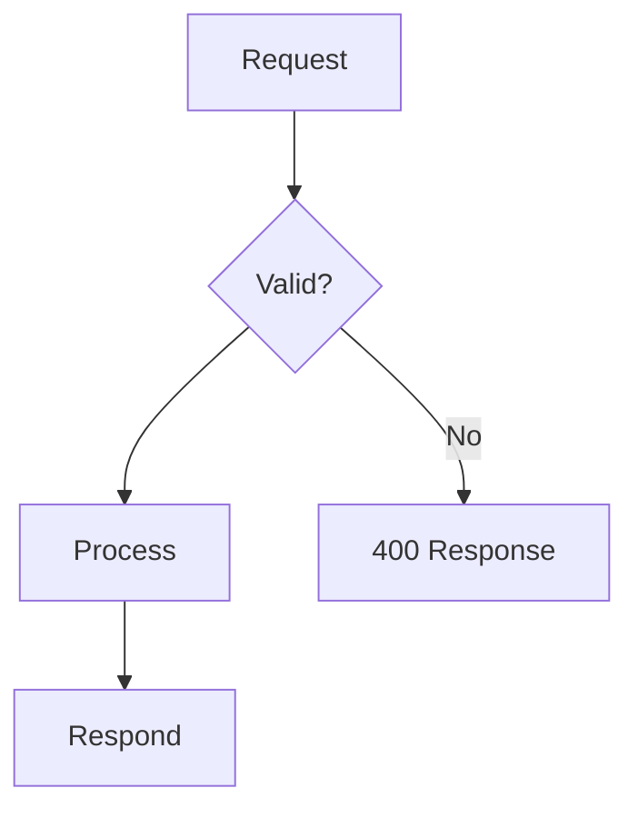
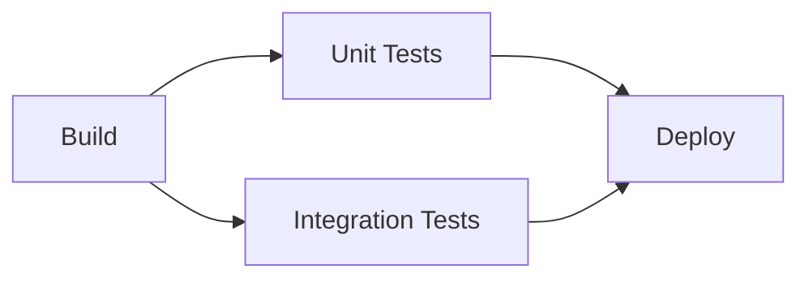
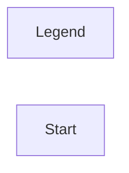
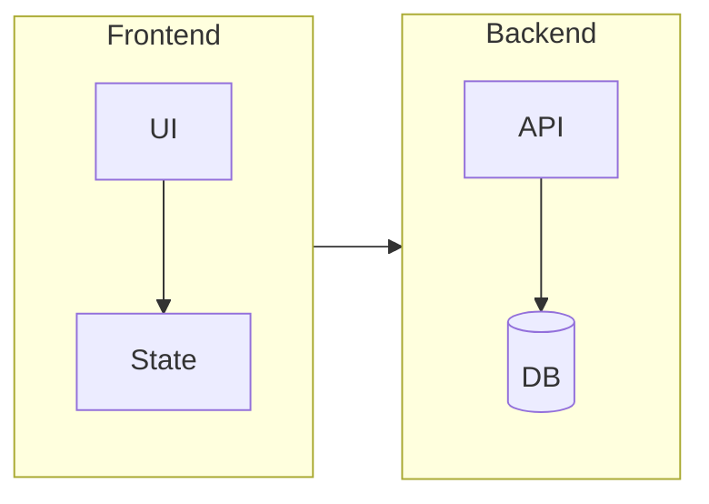
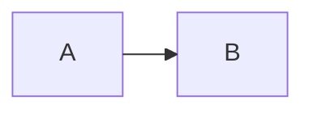

# Layout Patterns

Mermaid's layout is automatic (dagre by default; ELK optionally in v11+). You cannot
place nodes, but you have strong indirect control. Poor layout — tangled edges, odd
node ordering, sprawling diagrams — is almost always fixable with the techniques below.

## 1. Pick direction deliberately

```
flowchart LR    %% or TB, BT, RL
```

- **`LR` (left-to-right)**: processes, pipelines, request paths, anything sequential.
  Markdown pages are vertically scrolled and ~800–900px wide, so LR uses width well
  for chains up to ~6–8 nodes before it overflows and shrinks.
- **`TB` (top-to-bottom)**: hierarchies, decision trees, org-style structures, layered
  architectures, and any flow with heavy branching (branches spread horizontally,
  which reads better than LR's vertical fan).
- Long chain + target is a markdown page → prefer TB when the chain exceeds ~8 nodes;
  a very wide LR diagram gets scaled down until labels are unreadable.
- Never mix reading directions in one diagram except via subgraph `direction`.

## 2. Declaration order is layout control

Dagre ranks nodes roughly in the order edges are declared. The practical rules:

- **Declare the happy path first**, as one unbroken chain, then attach branches and
  error paths afterwards. This keeps the main flow in a straight line.



- **Group edge declarations by source node** so related edges rank together.
- Reordering declarations is the first tool to reach for when edges cross: move the
  declaration of the tangled branch earlier or later and re-render.

## 3. Use `&` for fan-out/fan-in instead of repeated lines



Compact, and it tells the layout engine these nodes are siblings of equal rank.

## 4. Control rank distance with link length

Extra dashes make a link span more ranks — use this to push a node further
away and relieve congestion:

```
A --> B      %% normal: adjacent ranks
A ----> B    %% longer: B pushed one extra rank
```

The same works for thick (`====>`) and dotted (`-..->`... pattern: `-...->`) links.

## 5. Invisible links for nudging

`A ~~~ B` creates a link that influences ranking but renders nothing. Use it to align
nodes that have no real relationship, or to force an ordering among siblings:



Use sparingly — more than 2–3 invisible links means the diagram is fighting its own
structure and should probably be restructured or split.

## 6. Subgraphs: group, title, and direct



- Give every subgraph an **ID and a quoted title**: `subgraph frontend["Frontend"]`.
  The ID lets you draw edges to/from the whole group (`frontend --> backend`).
- Maximum **two levels** of nesting; beyond that, split the diagram.
- **Known limitation**: a subgraph's internal `direction` statement is *ignored* when
  any edge connects a node inside the subgraph to a node outside it — the subgraph
  inherits the outer flow direction. If you need mixed directions, connect
  subgraph-to-subgraph (by ID) rather than node-to-node across the boundary.

## 7. Edge-crossing reduction checklist

Apply in order; re-render after each:

1. Reconsider the direction (`TB` vs `LR`).
2. Reorder declarations so nodes that connect are declared near each other.
3. Group related nodes into subgraphs — dagre keeps cluster members together.
4. Replace node-to-node cross-boundary edges with subgraph-to-subgraph edges.
5. Remove low-value edges (e.g., "everything talks to the logger" — say it in prose,
   or show the logger once with one representative edge).
6. If the renderer supports it, switch to ELK (`layout: elk`), which produces fewer
   overlaps on large/dense graphs.
7. If still tangled: the diagram is too big. Split it.

## 8. ELK layout (v11+; check renderer support first)



- ELK handles large, dense, and deeply nested diagrams noticeably better than dagre,
  and supports `mergeEdges` (bundles parallel edges) and several
  `nodePlacementStrategy` values (`BRANDES_KOEPF` default, `NETWORK_SIMPLEX`,
  `LINEAR_SEGMENTS`, `SIMPLE`).
- Applies to flowchart, state, class, ER, requirement diagrams.
- **GitHub's renderer does not honor `layout: elk`** (silently falls back) — treat
  ELK as available only in mermaid-cli, mermaid.live, and self-hosted renderers you
  control. See [06-renderer-compatibility.md](06-renderer-compatibility.md).
- Because misspelled config keys fail *silently*, double-check spelling: `layout`,
  not `renderer`.

## 9. Sequence/state/ER layout notes

- **Sequence**: layout = participant order. Declare participants explicitly in
  left-to-right narrative order; put the initiator first. Keep to ≤6–7 lifelines.
- **State**: `stateDiagram-v2` honors `direction TB|LR`; TB is conventional.
- **ER**: little layout control — the main lever is limiting entities (≤8) and
  attributes per entity.

## Sources

- Flowchart syntax (direction, links, subgraphs, invisible links, `&`):
  <https://mermaid.js.org/syntax/flowchart.html>
- Layout engines and ELK config: <https://mermaid.js.org/intro/syntax-reference.html>
- Subgraph direction limitation: flowchart docs ("direction … as long as it does not
  have any links leading in or out") and
  <https://github.com/mermaid-js/mermaid/issues/6785>
- GitHub ELK non-support (community report, unconfirmed by GitHub docs):
  <https://github.com/orgs/community/discussions/198799>
