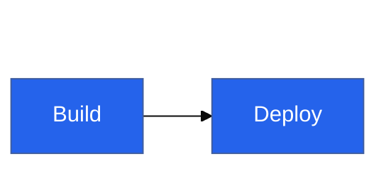
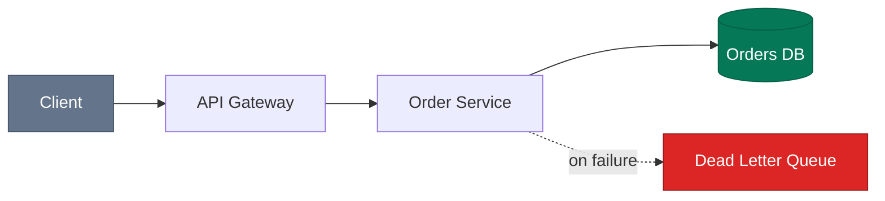

# Styling & Theming

Styling is where generated diagrams fail hardest: hardcoded pastel fills that turn
unreadable in dark mode, per-node `style` lines instead of classes, and `%%{init}%%`
directives that target renderers ignore. The patterns below produce diagrams that are
legible everywhere and have maintainable styling.

## 1. Configuration goes in YAML frontmatter, not `%%{init}%%`

- Frontmatter (supported since v10.5) is the documented, current mechanism;
  `%%{init: …}%%` directives are the legacy form and some platforms strip or ignore
  them. Emit frontmatter.
- The `---` fences must be the **first lines of the mermaid block**, alone on their
  lines. YAML is case-sensitive and indentation-sensitive; **misspelled keys fail
  silently**, so `theme`, `themeVariables`, `layout`, `look` must be exact.

## 2. The dark-mode contract (the single most important styling rule)

GitHub (and most doc platforms) render Mermaid with a theme matching the *viewer's*
color scheme — the author doesn't know the background color. Hardcoded colors that
assume a white page are the #1 reported cause of unreadable diagrams
(GitHub community discussion #35733: custom backgrounds + auto-adjusted text = no
contrast).

**Rules:**

1. **Default stance: don't set colors at all.** The renderer's built-in light/dark
   themes are guaranteed readable. An unstyled correct diagram beats a styled broken
   one.
2. **If you style a node, specify the complete triple**: `fill`, `stroke`, **and**
   `color` (text). Never set a fill and let text color float — that's exactly how
   white-on-white happens.
3. **Choose mid-tone fills with white text** from the WCAG-verified palette in
   [08-safe-palette.md](08-safe-palette.md) (`#2563eb`, `#7c3aed`, `#047857`,
   `#b45309`, `#dc2626`, `#64748b` — all with `color:#fff`). These hold ≥4.5:1 text
   contrast and ≥3:1 shape visibility on both white and GitHub-dark backgrounds.
   Avoid light pastels with dark text (invisible in dark mode) and very dark fills
   (invisible shapes in dark mode).
4. **Don't set page-dependent colors** (`background`, `edgeLabelBackground`,
   light-grey `clusterBkg`) unless you control the renderer and its theme.
5. Edge/line colors inherit from the theme; override `lineColor` only when you've
   verified both modes.

## 3. Themes: what they are and when to set one

| Theme | Use |
|---|---|
| `default` | Classic look; what most renderers use in light mode |
| `dark` | Dark-background counterpart |
| `neutral` | Black-and-white; best for print/PDF |
| `forest` | Green accent palette |
| `base` | **The only customizable theme** — required when setting `themeVariables` |
| `redux`, `redux-color`, `redux-dark(-color)`, `neo`, `neo-dark` | New v11.12+ families used with the `look` option; not available on older renderers |

- On shared platforms (GitHub), **don't pin a theme** — pinning `theme: default`
  forces light styling onto dark-mode viewers. Omit it and let the platform switch.
- For controlled renderers (mermaid-cli → SVG for a site you own), pin `theme: base`
  + `themeVariables` for brand-consistent output, or `neutral` for print.
- `themeVariables` only takes effect with `theme: base`.
- `darkMode: true` (a themeVariable) changes how *derived* colors are computed; it is
  not a theme switch.

## 4. Key themeVariables

Most other colors are **derived** from a handful of primaries — set the few below and
let Mermaid compute the rest; override specifics only when the derived result fails.

| Variable | Controls |
|---|---|
| `primaryColor` | Main node fill; many colors derive from it |
| `primaryTextColor` | Text on primary-colored nodes |
| `primaryBorderColor` | Border on primary nodes |
| `secondaryColor`, `tertiaryColor` | Second/third fill families |
| `lineColor` | Edges/arrows |
| `textColor` | General diagram text |
| `fontFamily`, `fontSize` | Typography (match the host page, e.g. `"Inter, sans-serif"`, `16px`) |
| `clusterBkg`, `clusterBorder` | Subgraph background/border (flowchart) |
| `edgeLabelBackground` | Behind edge labels (flowchart) |
| `nodeBorder`, `nodeTextColor` | Flowchart node specifics |
| `actorBkg`, `actorBorder`, `actorTextColor`, `actorLineColor` | Sequence actors/lifelines |
| `signalColor`, `signalTextColor` | Sequence message arrows/text |
| `activationBkgColor`, `activationBorderColor` | Sequence activation bars |
| `noteBkgColor`, `noteTextColor`, `noteBorderColor` | Notes |

## 5. Node styling: semantic `classDef`, never per-node `style`

Define a small vocabulary of classes named for *meaning*, apply with `:::`, and group
all styling at the bottom of the diagram:

- `classDef name fill:…,stroke:…,color:…` — always the full triple (rule 2 above).
- Apply via `node:::name` inline, or `class nodeA,nodeB name` for lists.
- A `classDef default fill:…` restyles all unclassed nodes — use with care.
- Per-node `style id fill:…` lines don't scale and invite inconsistency; reserve for
  one-off emphasis of a single node.
- 3–4 classes maximum, and the class names should read as a legend (`external`,
  `datastore`, `errorPath`, `highlight`) — if a reader can't guess the meaning from
  the name, the color scheme is decoration.

## 6. Edge styling

- Use the **semantic link types** before reaching for CSS: `-->` normal, `-.->` 
  dotted (optional/async/fallback), `==>` thick (primary/emphasized path), `--x`
  failure, `--o` aggregation-ish.
- `linkStyle 2 stroke:#dc2626` targets edges **by declaration index** — brittle (any
  edge added above shifts the index). Avoid in documents that will be edited; prefer
  dotted/thick semantics or edge IDs (`e1@-->` with `class e1 …`, v11.1+) where the
  renderer supports them.

## 7. `look` (v11.12+, controlled renderers only)

`look: neo` (modern flat), `look: handDrawn` (sketch style, good for draft/proposal
diagrams), `look: classic`. Set via frontmatter `config.look`. Don't emit for GitHub
or unknown renderers — older Mermaid versions ignore or choke on unknown config.

## 8. Sequence-diagram styling specifics

- Prefer structure over color: `box` groupings, `rect rgb(…)` background bands for
  phases, `autonumber` for reference.
- `rect` background colors are hardcoded RGB — pick translucent-looking mid-tones
  and verify in dark mode, or skip them on shared platforms.

## Sources

- Theming (themes, themeVariables, base-only customization):
  <https://mermaid.js.org/config/theming.html>
- Frontmatter config: <https://mermaid.js.org/config/configuration.html> and
  <https://mermaid.js.org/intro/syntax-reference.html>
- Flowchart `classDef`/`class`/`:::`/`linkStyle`/edge IDs:
  <https://mermaid.js.org/syntax/flowchart.html>
- Dark-mode breakage report: <https://github.com/orgs/community/discussions/35733>
