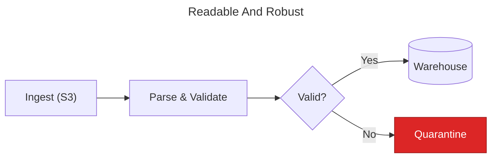

# Syntax Pitfalls

Mermaid's parser is unforgiving in some places and silently lenient in others:
"unknown words and misspellings will break a diagram, while parameters silently fail"
(official syntax reference). These are the known traps, each with the defensive
pattern that avoids it.

## 1. The `end` keyword (flowchart & sequence)

Lowercase `end` as a node ID or unquoted label **breaks flowcharts** (it terminates
subgraphs) and can break sequence diagrams (it terminates `alt`/`loop`/`par` blocks).

```text
flowchart LR
    start --> end          %% BROKEN
    start2 --> endNode["End"]   %% OK: different ID, quoted label
```

**Rule:** never use bare `end` — capitalize (`End`, `END`) or, better, use a
different ID with a quoted label.

## 2. Leading `o` / `x` after an edge (flowchart)

`A---oB` parses as a **circle edge** to `B`; `A---xB` as a **cross edge**. Any node
ID starting with lowercase `o` or `x` directly after a link is at risk.

**Rule:** put a space between link and node (`A --- oB`) — which the "space around
links" formatting habit gives you for free — or capitalize.

## 3. Unquoted special characters in labels

`()`, `[]`, `{}`, `<`, `>`, `#`, `;`, `/`, `\`, and keywords inside an unquoted label
break parsing because they collide with shape delimiters.

```text
id1[This breaks (badly)]          %% BROKEN
id1["This renders (fine)"]        %% OK
```

**Rules:**
- **Always double-quote every label** — nodes, edges, subgraph titles. This is the
  blanket fix; apply it unconditionally rather than deciding per-label.
- A literal double quote inside a quoted label: use the entity `#quot;`.
- Other unrenderable characters: HTML entity codes work with `#` instead of `&` —
  `#9829;` (decimal) or named codes (`#amp;`...).
- Line breaks inside labels: `<br/>`.

## 4. Frontmatter formatting

- The opening `---` must be the **first line** of the mermaid source, the closing
  `---` alone on its line, no leading whitespace on either.
- YAML keys are case-sensitive (`themeVariables`, not `themevariables`).
- **Misspelled config keys are silently ignored** — a typo'd `layot: elk` won't
  error, the diagram just renders with dagre. Malformed YAML, by contrast, breaks
  the whole diagram.

## 5. Comments

- `%%` starts a comment; put comments **on their own line**.
- **Never put `{}` inside a `%%` comment** — the parser may read it as a directive
  (`%%{…}%%`) and break.

## 6. Markdown fencing context

- The fence must be exactly ` ```mermaid ` (lowercase), with a blank line before the
  fence in most renderers.
- Inside a markdown **list item**, indent the entire fenced block to the list's
  continuation indent, consistently, or the fence terminates the list / fails to
  render.
- If the document shows mermaid source instead of a diagram, the renderer doesn't
  support mermaid (or the tag is misspelled) — see
  [06-renderer-compatibility.md](06-renderer-compatibility.md).
- Diagrams in `<details>` blocks on GitHub: keep a blank line after `<summary>` or
  the block won't render as markdown.

## 7. Diagram-type keyword and first line

- The first non-frontmatter word **is** the diagram type (`flowchart`,
  `sequenceDiagram`, `stateDiagram-v2`, `erDiagram`…). Any typo = total failure.
- Direction belongs on the same line for flowcharts: `flowchart LR`.
- Use `stateDiagram-v2`, never `stateDiagram`; prefer `flowchart` over legacy `graph`.

## 8. Sequence-diagram specifics

- Participant IDs with spaces need aliases: `participant api as API Gateway`.
- Every `activate` needs a matching `deactivate` (or use the `+`/`-` shorthand
  symmetrically); unbalanced activations are a render error.
- The word `end` inside notes/labels: enclose in quotes/brackets/parens.

## 9. Things that look like features but break portability

- `click nodeId href "…"` / `click nodeId call …` — interaction features. Stripped
  or disabled on sandboxed renderers (GitHub). Don't emit for markdown docs.
- FontAwesome icons (`fa:fa-car`) require the host page to load FontAwesome; on
  GitHub they render as literal text. Avoid.
- HTML in labels beyond `<br/>` — depends on `htmlLabels` config and the platform's
  sanitizer. Avoid.
- Very new syntax (node shape `@{ shape: … }` metadata, edge IDs `e1@-->`,
  `architecture-beta`) needs a v11.1+ renderer — verify before use.

## 10. Defensive authoring pattern (summary)



Every label quoted, no bare `end`, semantic IDs, frontmatter title, accessibility
lines, styling grouped at the bottom with full fill/stroke/color triples.

## Sources

- Syntax reference ("diagram breakers"): <https://mermaid.js.org/intro/syntax-reference.html>
- Flowchart warnings (`end`, `o`/`x`, quoting, entities):
  <https://mermaid.js.org/syntax/flowchart.html>
- Sequence `end` note: <https://mermaid.js.org/syntax/sequenceDiagram.html>
