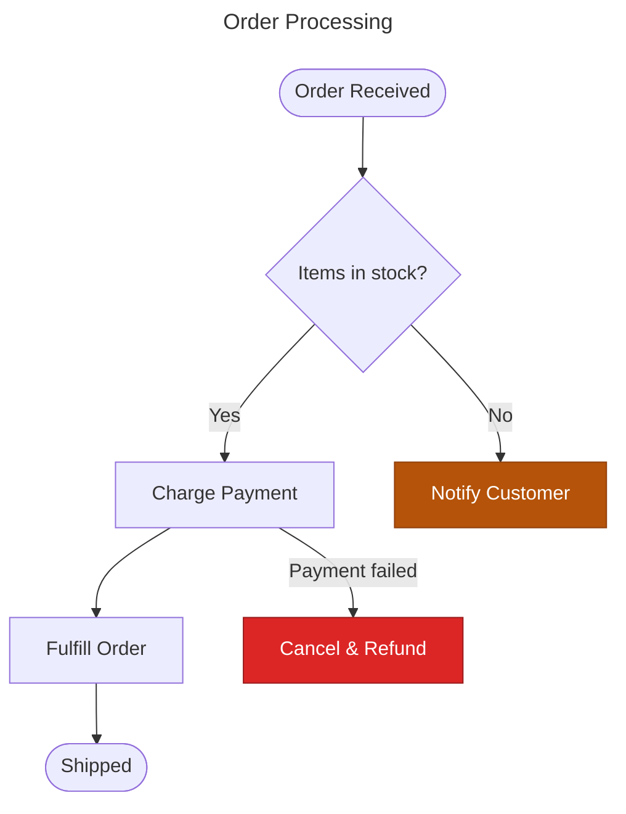
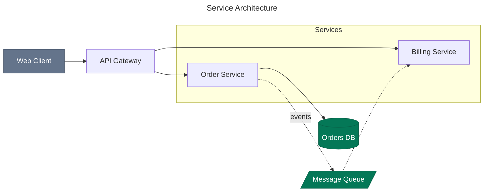
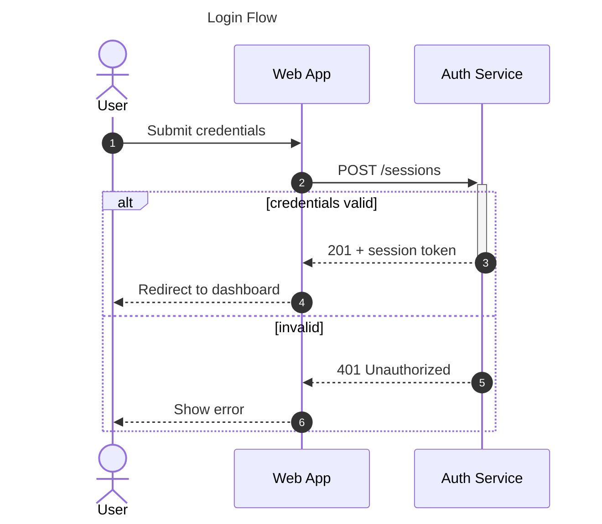
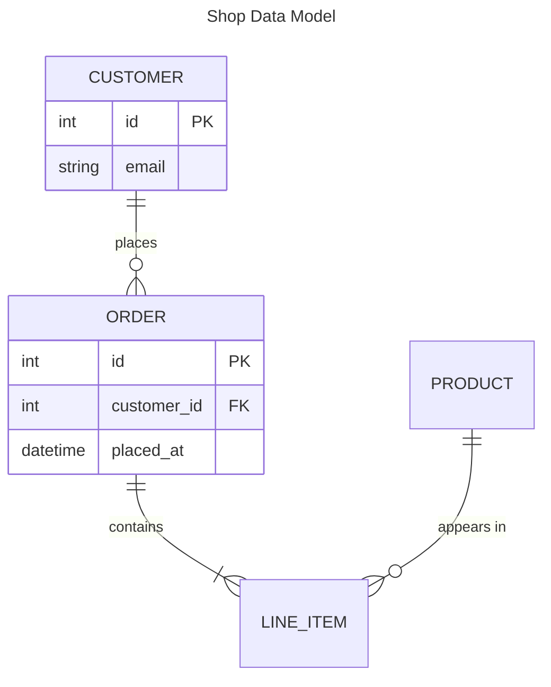
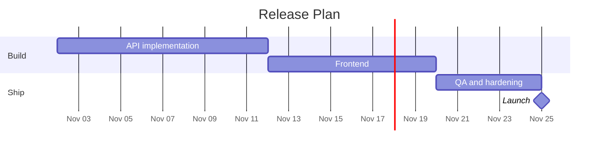

# Validated Starter Templates

Copy-paste skeletons embodying every rule in docs 01–08: quoted labels, semantic IDs,
frontmatter title, accessibility lines, happy-path-first declaration order, verified
palette classes. All templates in this file parse with mermaid-cli (see commit-time
validation). These are the templates the skill should emit and adapt — not invent
structure from scratch.

## Flowchart — process with decision and error path

Pattern notes: happy path declared first as one chain; branches attached after;
stadium terminators; diamond decision with labeled outcomes; styling grouped last.

## Flowchart — system architecture with subgraphs

Pattern notes: subgraph with ID + quoted title; `&` fan-out; dotted edges = async;
cylinder = DB; shapes/colors as vocabulary, not decoration.

## Sequence diagram — API interaction

Pattern notes: participants declared up front in narrative order with readable
aliases; `actor` for humans; `autonumber`; activation via `+`/`-`; branches as
`alt`/`else` blocks, not duplicate flows.

## State diagram — lifecycle

```mermaid
---
title: Order Lifecycle
---
stateDiagram-v2
    accTitle: Order lifecycle
    accDescr: Orders move from pending through paid and shipped; cancellation is possible before shipping.

    [*] --> Pending
    Pending --> Paid: payment confirmed
    Pending --> Cancelled: customer cancels
    Paid --> Shipped: dispatched
    Paid --> Cancelled: refund issued
    Shipped --> [*]
    Cancelled --> [*]
```

Pattern notes: `stateDiagram-v2`; `[*]` initial/final; transitions labeled with the
triggering *event*; one noun-state vocabulary.

## ER diagram — data model

Pattern notes: every relationship labeled with a verb phrase; attributes limited to
keys plus defining fields; multi-word labels quoted.

## Gantt — phased plan

Pattern notes: `after <id>` dependencies instead of hand-computed dates; `milestone`
for zero-duration events; sections as phases.

## Adaptation rules for the skill

1. Start from the template matching the selected diagram type; rename IDs/labels to
   the domain. Don't restructure unless the content demands it.
2. Delete what isn't needed (styling classes, `alt` blocks) rather than leaving
   placeholder content.
3. Only add classDefs when color carries meaning; pull fills exclusively from
   [08-safe-palette.md](08-safe-palette.md).
4. Re-validate after adaptation (`mmdc`) — templates guarantee a valid *starting*
   point, not a valid result.
