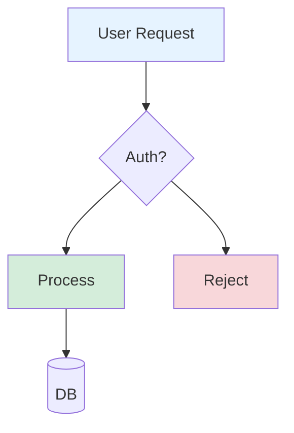
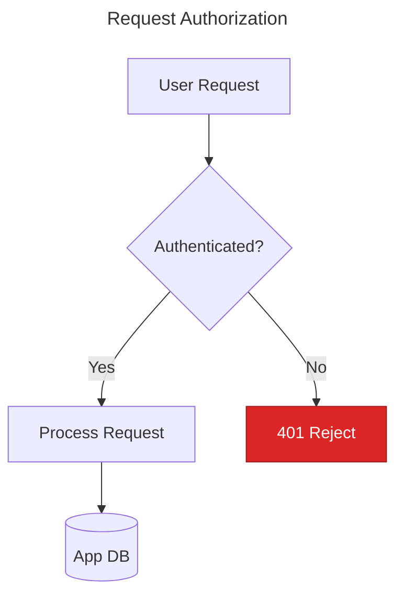
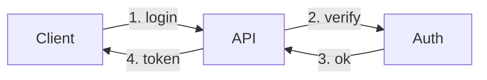
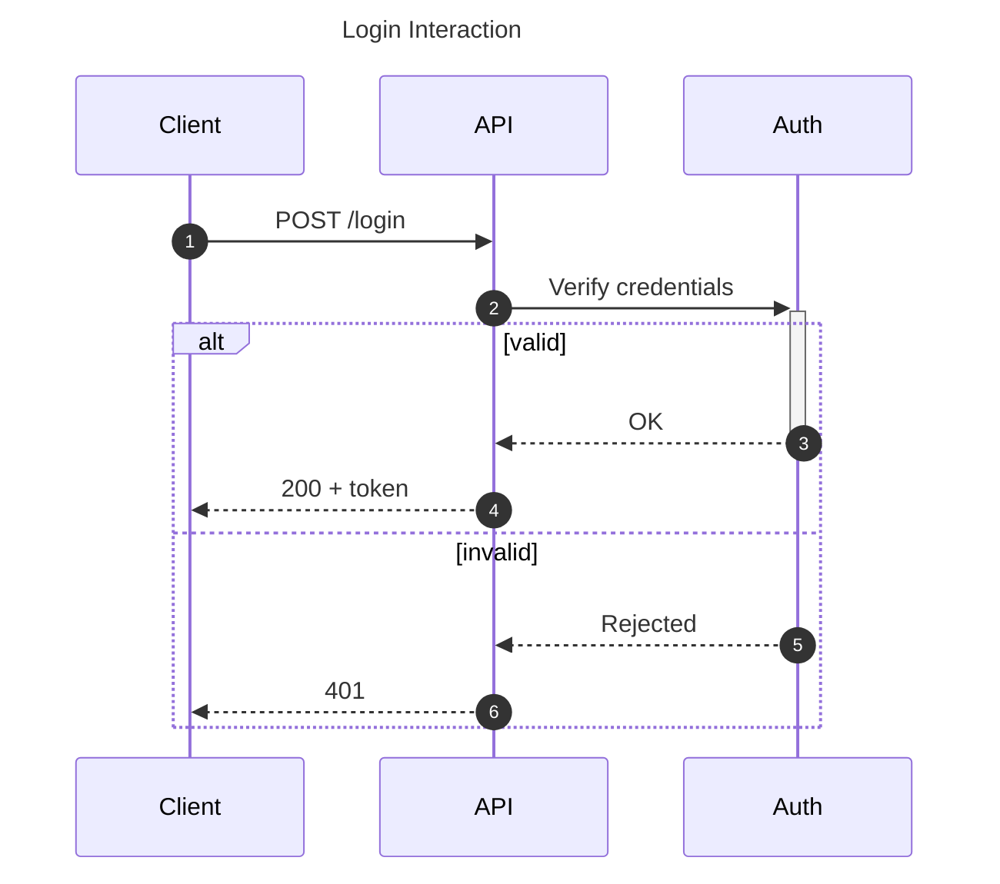
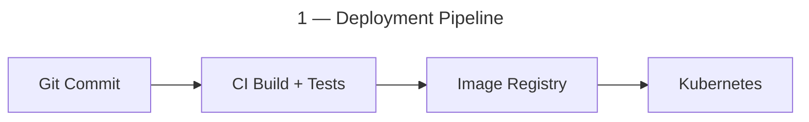
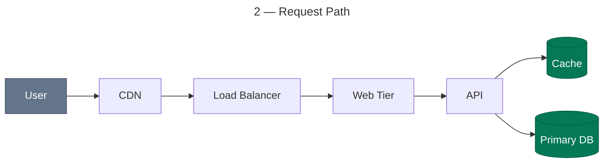
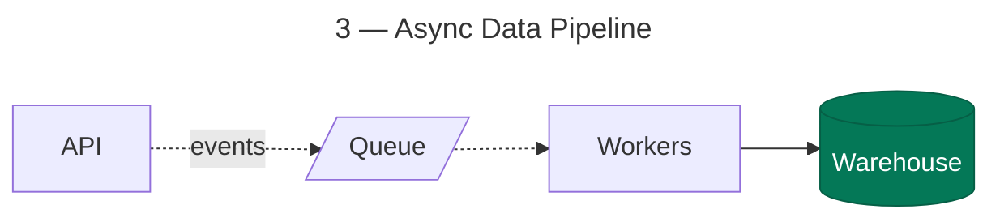
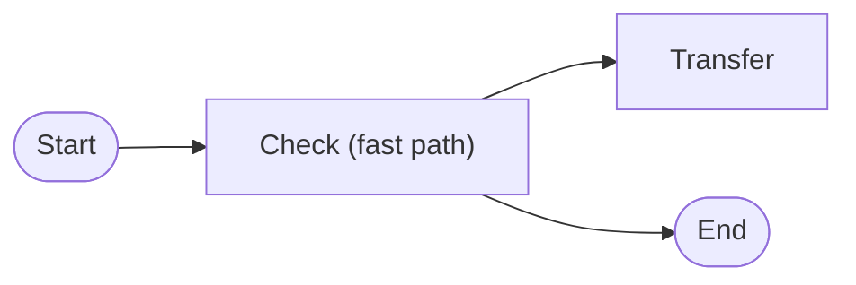

# Worked Examples: Typical Generated Diagram → Fixed

Before/after pairs showing the exact failure modes the skill exists to prevent, each
mapped to the rules that fix it. These make good few-shot material for the skill's
SKILL.md or references.

## Example 1 — Meaningless IDs, decorative pastels, broken dark mode

**Before** (parses, but unmaintainable and unreadable in dark mode — light pastel
fills with no text color, legacy `graph`, single-letter IDs, unquoted labels):



**After** (semantic IDs, quoted labels, decision outcomes labeled, color only where
it means something, full fill/stroke/color triples from the verified palette):



Rules applied: 01 §3 (IDs/labels), 01 §7 + 04 §2 (color), 05 §3 (quoting),
05 §7 (`flowchart` over `graph`).

## Example 2 — Flowchart misused for a time-ordered interaction

**Before** (services as boxes, calls as edges — ordering, sync/async, and the
response path are invisible; numbered edge labels fake what sequence diagrams do
natively):



**After** (same content as a sequence diagram — lifelines, activation span, the
failure branch that the flowchart version silently omitted):



Rule applied: 02 ("if time flows through the picture, it's a sequence diagram").

## Example 3 — The everything-diagram

**Before** (one diagram trying to show deployment, request path, and data pipeline
at once; 20+ nodes, guaranteed edge tangle — abbreviated here):

```text
flowchart TD
    dev --> git --> ci --> registry --> k8s
    user --> cdn --> lb --> web --> api --> cache & db
    api --> queue --> workers --> warehouse
    ci --> tests
    workers --> alerts
    k8s --> web & api & workers
    ...
```

**After**: not one better diagram — **three diagrams**, each one idea at one
abstraction level, linked by prose:







Rules applied: 01 §2 (one idea, 5–15 nodes, one abstraction level), 03 §7 step 7
(still tangled → split).

## Example 4 — Parser landmines

**Before** (three independent breakages: bare `end` node, `--x` misparse risk from a
node ID starting with `x`, unquoted parentheses):

```text
flowchart LR
    start --> check[Check (fast path)]
    check --> xfer
    check --> end
```

**After**:



Rules applied: 05 §1 (`end`), 05 §2 (`o`/`x` IDs — renamed, which also improves the
label), 05 §3 (quote everything).

## The meta-pattern

Every "after" is *less* syntax than a naive fix would add: fewer nodes, fewer colors,
fewer edge labels. Improving a generated diagram is mostly deletion plus relocation
of detail into prose — the skill should treat "add more styling" as a smell and
"split or simplify" as the default remedy.
